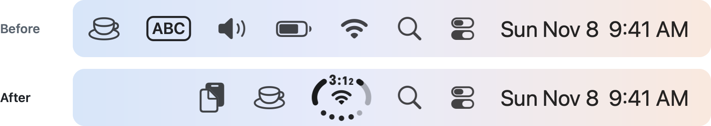
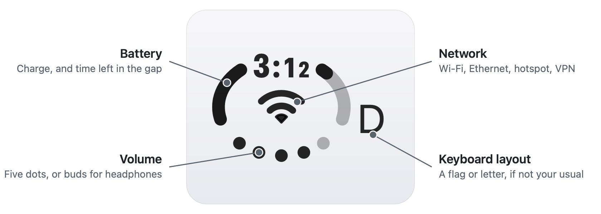
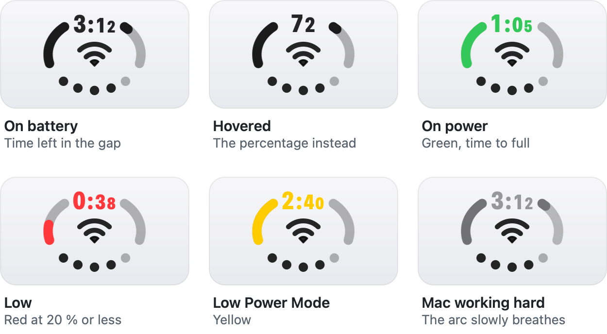
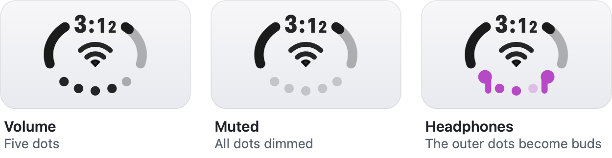
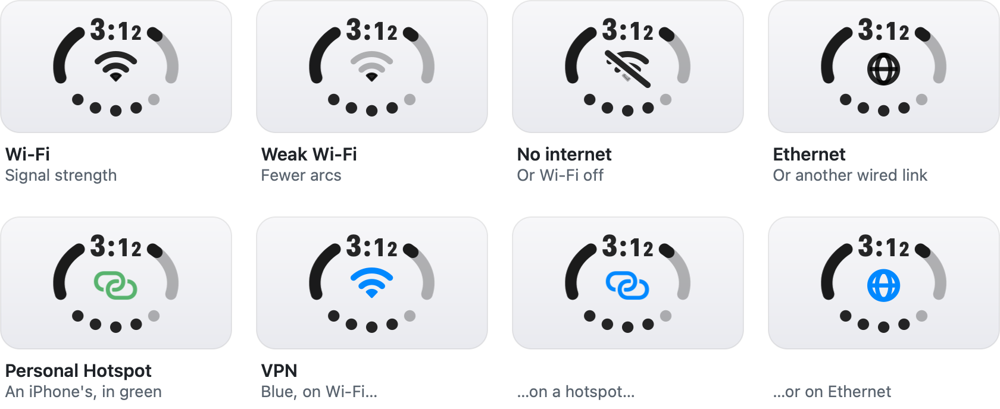
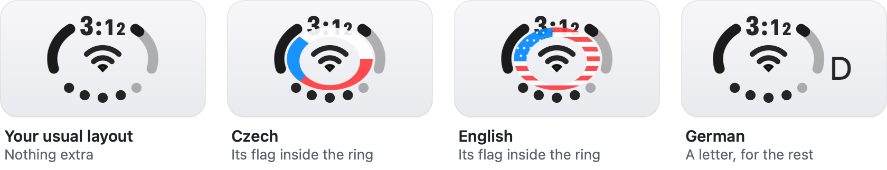

<h1 align="center">QuadStatus</h1>

<p align="center">
  <b>Battery, volume, network and keyboard layout in one small badge in the Mac menu bar.</b><br>
  Four system icons in the space of one, with the details a click away.
</p>

<p align="center">
  <a href="https://github.com/chocholous/QuadStatus/releases/latest"></a>
  
  <a href="LICENSE"></a>
</p>

<p align="center">
  <picture>
    <source media="(prefers-color-scheme: dark)" srcset="docs/preview/hero-dark.png">
    
  </picture>
</p>

## Why

The right end of a MacBook's menu bar fills up fast, and four of its icons only report
status: Wi-Fi, Sound, Battery and the input menu. QuadStatus draws all four into one round
badge, so you can hide the system ones and get the room back.

<p align="center">
  <picture>
    <source media="(prefers-color-scheme: dark)" srcset="docs/preview/before-after-dark.png">
    
  </picture>
</p>

It also tells you a little more than the icons it replaces: time left on battery right in
the badge, a glance at AirPods battery when they connect, whether a VPN is up, and a
gentle pulse when the Mac is working hard.

## Install

```bash
brew install --cask chocholous/tap/quadstatus
```

Or download the `.dmg` from the [latest release](https://github.com/chocholous/QuadStatus/releases/latest)
and drag **QuadStatus** into **Applications**.

> [!NOTE]
> The app is not yet signed with an Apple Developer ID or notarized, so macOS blocks the
> first launch either way: open it once, then go to **System Settings → Privacy & Security**
> and click **Open Anyway**. Each release lists the SHA-256 of its disk image, and the cask
> checks it.

Then:

1. Turn on **Open at Login** in its menu, so it starts as soon as you log in.
2. Hide the icons it replaces. QuadStatus doesn't touch your settings, so this is up to you:
   **System Settings → Menu Bar** for Wi-Fi, Sound and Battery, and
   **System Settings → Keyboard → Input Sources** for *Show Input menu in menu bar*.

Runs on macOS 14 or later, Apple silicon and Intel. English and 简体中文.

## Reading the badge

<p align="center">
  <picture>
    <source media="(prefers-color-scheme: dark)" srcset="docs/preview/anatomy-dark.png">
    
  </picture>
</p>

The badges on this page are drawn by the app's own drawing code, so they're exactly what
your menu bar shows, only larger.

### Battery

The arc fills clockwise from the left. Its gap holds the time left on battery, or the time
to full on power; hover over the badge and it shows the percentage instead. Under heavy
CPU load or thermal pressure the arc slowly breathes, until the Mac calms down.

<p>
  <picture>
    <source media="(prefers-color-scheme: dark)" srcset="docs/preview/battery-dark.png">
    
  </picture>
</p>

### Sound

Five dots for the volume of the current output. With headphones (Bluetooth or the
headphone jack) the outer two turn into ear buds, and when AirPods connect, their battery
shows next to the badge for a few seconds.

<p>
  <picture>
    <source media="(prefers-color-scheme: dark)" srcset="docs/preview/sound-dark.png">
    
  </picture>
</p>

### Network

Wi-Fi with its signal strength, struck through with no internet or Wi-Fi off, a globe for
Ethernet and other wired links, and green links for an iPhone's Personal Hotspot.
When a VPN is up, the glyph turns blue, whatever the connection.

<p>
  <picture>
    <source media="(prefers-color-scheme: dark)" srcset="docs/preview/network-dark.png">
    
  </picture>
</p>

### Keyboard layout

Your usual layout shows nothing. Switch to another and the badge says so: the flag of its
language inside the ring for Czech and English, or its letter beside the badge for the rest.

<p>
  <picture>
    <source media="(prefers-color-scheme: dark)" srcset="docs/preview/keyboard-dark.png">
    
  </picture>
</p>

## The menu


Click the badge for the details:

- **Battery:** charge, battery health and cycle count, time left or to full, the charger's
  watts.
- **Network:** the connection and Wi-Fi name, live download and upload speed, latency and
  packet loss to your router.
- **VPN**, with NordVPN installed: whether a tunnel is up, connect to a country, open the app.
- **Sound:** the volume or *Muted*, and the output and input device, each switchable.
- **Keyboard:** the current layout, and all your enabled ones to switch to.
- **Language**, **Open at Login**, **Quit**.

Hover over the badge for a short tip: the network, the VPN country, battery and time left,
AirPods levels, the active Focus and, when it's high, CPU load.

<br clear="right">

## Privacy

- **No permissions required.** macOS only reveals the Wi-Fi network's *name* to apps with
  location access; if you want the name in the menu, allow it from the menu. QuadStatus
  never reads your location. Everything else (signal, battery, audio, load) works without it.
- **No network requests of its own,** apart from pinging your router while the menu is open.
- **No data leaves your Mac.**

The full list of what it runs and reads is in [SECURITY.md](SECURITY.md), which is also
where to report a vulnerability.

<details>
<summary><b>Settings</b></summary>

A few things are set with `defaults`:

```bash
# The layout that shows nothing in the menu bar (default: the first one enabled in System Settings)
defaults write io.github.chocholous.quadstatus defaultKeyboardLanguage -string en
# Countries offered under VPN → Connect to
defaults write io.github.chocholous.quadstatus vpnCountries -array cz us de gb
# How long AirPods battery stays next to the badge, in seconds
defaults write io.github.chocholous.quadstatus airPodsBatterySeconds -float 8
```

</details>

<details>
<summary><b>Build from source</b></summary>

```bash
./build.sh               # build build.noindex/QuadStatus.app
./build.sh --install     # build, install to ~/Applications, start at login
./build.sh --dmg         # build the disk image
./build.sh --previews    # redraw the README images in docs/preview
```

Building needs Xcode 27.

</details>

<details>
<summary><b>Notes for developers</b></summary>

- macOS 27 hides menu item images unless you set `preferredImageVisibility = .visible`.
- Timers don't fire while a menu is open; they need `RunLoop.main.add(timer, forMode: .common)`.
- `NSStatusBar.thickness` reports 22pt, but the button grows with the image — 32pt still isn't clipped.
- Location permission gates the Wi-Fi *name* only. RSSI, noise, channel and transmit rate read fine without it.
- Battery health isn't in IORegistry. `system_profiler SPPowerDataType` has it, in 0.09s.
- ICMP works without root: `socket(AF_INET, SOCK_DGRAM, IPPROTO_ICMP)`.
- Round line caps extend `stroke/2` past the endpoint, so arc gaps are `(gap + stroke) / radius`.
- An ad-hoc signed app can't start at login through `SMAppService.agent` on macOS 27: launchd
  kills it with a launch constraint violation. A plain LaunchAgent in `~/Library/LaunchAgents` works.

</details>

## License

MIT, see [LICENSE](LICENSE). Based on [DuoStatus](https://github.com/zhenweiding-dev/DuoStatus) by Zhenwei Ding.
