# QuadStatus

Battery, volume, network and keyboard layout in one round badge in the Mac menu bar,
instead of a row of separate icons. The details live in its menu.

<p align="center">
  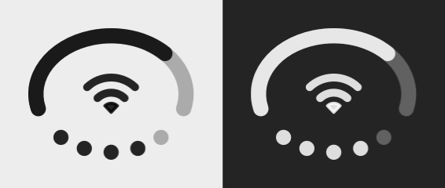
</p>

QuadStatus started as a fork of [DuoStatus](https://github.com/zhenweiding-dev/DuoStatus)
by Zhenwei Ding, which brought the iPhone Duo's "everything in one circle" status cluster
to the Mac. It adds headphones, VPN, keyboard layout, system load, a hover tip and a
login agent that starts with the session.

## Install

```bash
brew install --cask chocholous/tap/quadstatus
```

Or download the `.dmg` from the [latest release](https://github.com/chocholous/QuadStatus/releases/latest)
and drag **QuadStatus** into **Applications**.

The app is not yet signed with an Apple Developer ID or notarized, so macOS blocks the first
launch either way: open it once, then **System Settings → Privacy & Security → Open Anyway**.
Each release lists the SHA-256 of its disk image, and the cask checks it.

Turn on **Open at Login** in its menu and it starts as soon as you log in.

macOS 14 or later, Apple silicon and Intel. English and 简体中文.

## The badge

All previews below are drawn by the app's own drawing code, six times larger than in the
menu bar, on a light and a dark menu bar.

### Battery: the arc on top

| | |
|---|---|
|  | **Charge level.** The arc fills clockwise from the left. |
| 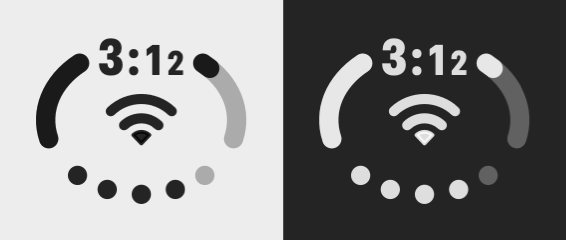 | **Time left** on battery, set into the top of the arc. Hover the badge and it shows the percentage instead. |
| 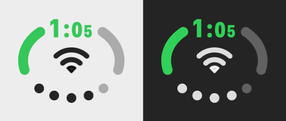 | **On power** the arc turns green and shows the time to full. |
| 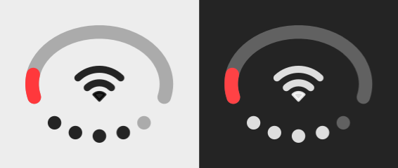 | **20 % or less** turns it red. |
| 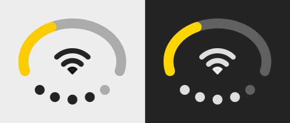 | **Low Power Mode** turns it yellow. |
| 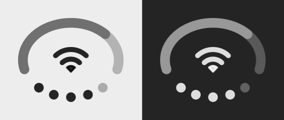 | **Mac working hard.** Under heavy CPU load or thermal pressure the arc slowly breathes. |

### Sound: the dots at the bottom

| | |
|---|---|
|  | **Volume** of the current output, in five dots. |
| 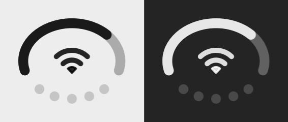 | **Muted** dims all of them. |
| 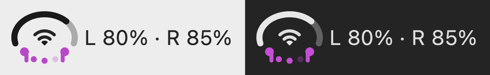 | **Headphones.** The outer dots become ear buds. When AirPods connect, their battery shows next to the badge for a few seconds. |

### Network: the centre

| | |
|---|---|
|  | **Wi-Fi** with its signal strength. |
| 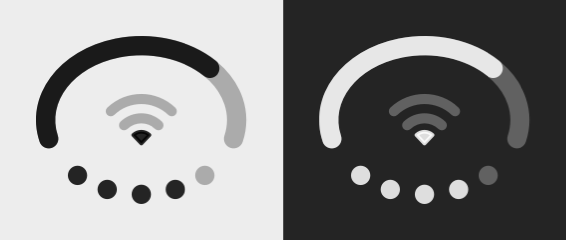 | **Weak signal**, fewer arcs. |
| 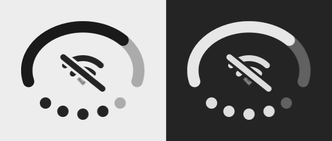 | **No internet** or Wi-Fi off, struck through. |
| 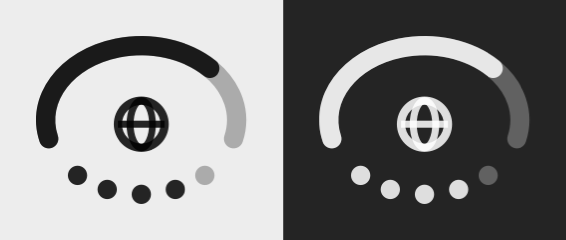 | **Ethernet** and other wired connections, a globe. |
| 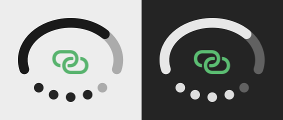 | **iPhone Personal Hotspot**, green. |
| 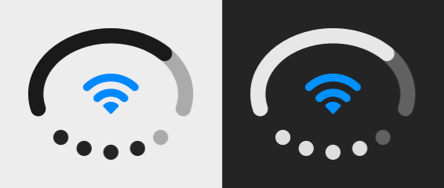 | **VPN up** turns the Wi-Fi glyph blue. |

### Keyboard layout

| | |
|---|---|
|  | **Your usual layout** shows nothing. |
| 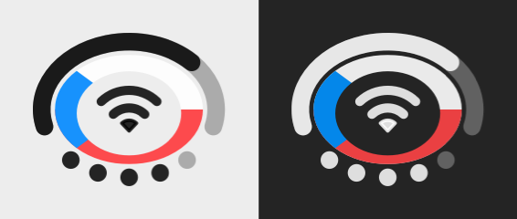 | **Switched away from it**, a band in the flag of the language, for languages that have one (Czech, English)… |
| 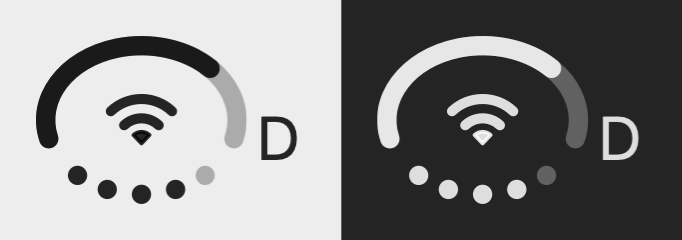 | …or its letter for the rest. |

## The menu

<p align="center">
  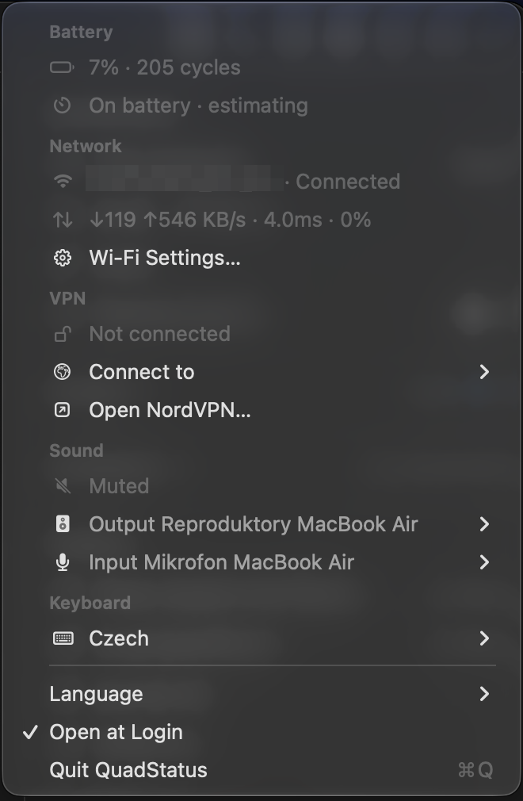
</p>

- **Battery:** charge, battery health and cycle count, time left or to full, charger watts.
- **Network:** connection and Wi-Fi name, live download and upload speed, gateway latency and packet loss.
- **VPN:** whether a tunnel is up, and NordVPN shortcuts: connect to a country, open the app.
- **Sound:** pick the output and input device, see when it's muted.
- **Keyboard:** switch between your enabled layouts.
- **Language**, **Open at Login**, **Quit**.

Hovering over the badge shows a short tip with the network, VPN country, battery time,
AirPods levels, the active Focus and CPU load.

## Permissions

None are required. macOS only reveals the Wi-Fi network's **name** to apps with location
access. If you want the name in the menu, allow it from the menu. QuadStatus never reads
your location. Everything else (signal, battery, audio, load) works without permission.

QuadStatus makes no network requests of its own, apart from pinging your router while the
menu is open.

## Settings

A few things are set with `defaults`:

```bash
# The layout that shows nothing in the menu bar (default: the first one enabled in System Settings)
defaults write io.github.chocholous.quadstatus defaultKeyboardLanguage -string en
# Countries offered under VPN → Connect to
defaults write io.github.chocholous.quadstatus vpnCountries -array cz us de gb
# How long AirPods battery stays next to the badge, in seconds
defaults write io.github.chocholous.quadstatus airPodsBatterySeconds -float 8
```

## Build

```bash
./build.sh               # build build.noindex/QuadStatus.app
./build.sh --install     # build, install to ~/Applications, start at login
./build.sh --dmg         # build the disk image
./build.sh --previews    # redraw the README previews in docs/preview
```

Building needs Xcode 27.

## Notes

- macOS 27 hides menu item images unless you set `preferredImageVisibility = .visible`.
- Timers don't fire while a menu is open; they need `RunLoop.main.add(timer, forMode: .common)`.
- `NSStatusBar.thickness` reports 22pt, but the button grows with the image — 32pt still isn't clipped.
- Location permission gates the Wi-Fi *name* only. RSSI, noise, channel and transmit rate read fine without it.
- Battery health isn't in IORegistry. `system_profiler SPPowerDataType` has it, in 0.09s.
- ICMP works without root: `socket(AF_INET, SOCK_DGRAM, IPPROTO_ICMP)`.
- Round line caps extend `stroke/2` past the endpoint, so arc gaps are `(gap + stroke) / radius`.
- An ad-hoc signed app can't start at login through `SMAppService.agent` on macOS 27: launchd
  kills it with a launch constraint violation. A plain LaunchAgent in `~/Library/LaunchAgents` works.

## License

MIT. Copyright © 2026 Zhenwei Ding (DuoStatus) and Pavel Chocholouš.
